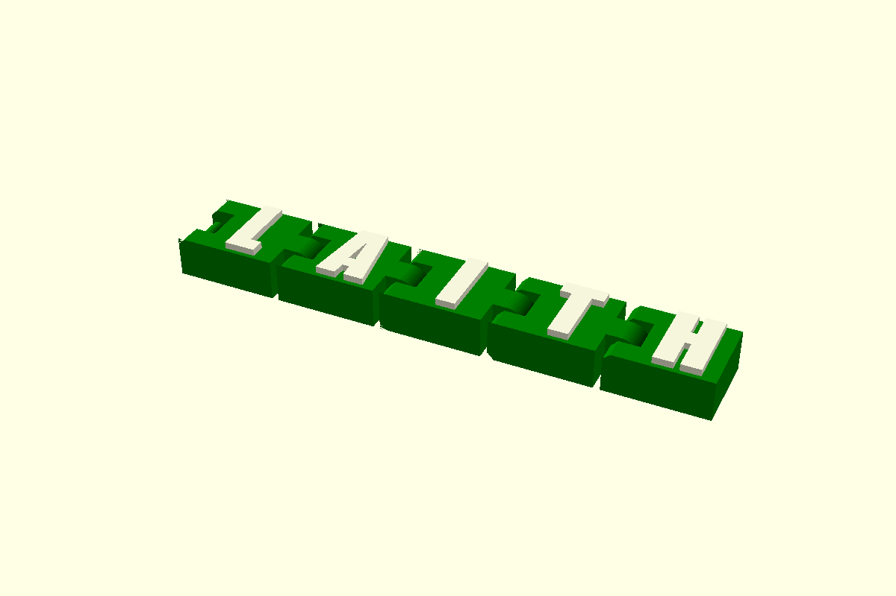

# 🔑 Parametric 3D Mechanical Keychain Maker
### صانع الميداليات وسلاسل المفاتيح الميكانيكية ثلاثية الأبعاد (بارامتري)

<p align="center">
  
</p>

<p align="center">
  
  
  
  
  
</p>

---

## 📖 English Overview

**Parametric 3D Mechanical Keychain Maker** is an open-source desktop application built with **Python**, **PyQt6**, and **OpenSCAD**. It allows makers, designers, and 3D printing enthusiasts to easily design customized, articulated, print-in-place mechanical keychains with raised lettering.

Each letter of the custom text is placed onto an articulated mechanical link that bends and flexes freely straight off the 3D print bed without assembly!

### ✨ Key Features
- 🔤 **Dynamic Text & Articulation**: Enter any name or text; the app automatically calculates the number of interlocking links required.
- 🎨 **Multi-Color Support**: Direct export to multi-color **3MF format**, natively compatible with Bambu Studio, OrcaSlicer, and PrusaSlicer (base and text separated with distinct filament colors).
- 🖨️ **Dual STL Export**: Generates combined STLs or separate base & text STLs for dual-extrusion printers.
- 🌐 **Interactive 3D Preview**: In-browser WebGL (Three.js) viewer to inspect the 3D model, rotate, and zoom in real time before exporting.
- 🖼️ **2D Orthographic Previews**: Fast isometric and top-down rendering generated directly by OpenSCAD.
- 🖋️ **Custom Typography**: Supports bold fonts like *Impact, Arial Black, Bungee, Bangers, Archivo Black, Bebas Neue*, etc.
- 📏 **Fine-tuned Dimensions**: Complete control over link width, height, length, chamfer, relief depth, and tolerances.

---

## 📖 نظرة عامة باللغة العربية

**صانع الميداليات وسلاسل المفاتيح الميكانيكية ثلاثية الأبعاد (Parametric 3D Mechanical Keychain Maker)** هو تطبيق مكتبي مفتوح المصدر ومبني باستخدام **بايثون (Python)**، واجهة **PyQt6**، ومحرك التصميم البرمجي **OpenSCAD**. يتيح لك التطبيق تصميم وصناعة سلاسل مفاتيح وميداليات ميكانيكية متمفصلة قابلة للطباعة مباشرة دفعة واحدة (Print-in-Place) دون الحاجة لتركيب بعد الطباعة.

كل حرف من النص يتم توليده فوق وصلة ميكانيكية متحركة، مما يعطي الميدالية مرونة وملمساً فريداً وجذاباً.

### ✨ المميزات الرئيسية
- 🔤 **نص مخصص وروابط متحركة**: اكتب أي اسم أو نص، وسيقوم البرنامج تلقائياً بحساب وتوليد عدد الحلقات والمفاصل بدقة.
- 🎨 **دعم الطباعة متعددة الألوان (Multi-Color 3MF)**: تصدير مباشر بصيغة **3MF** مع فصل ألوان القاعدة والحروف، متوافق مباشرة مع برامج التقطيع مثل Bambu Studio و OrcaSlicer و PrusaSlicer.
- 🖨️ **تصدير STL مفصول أو مدمج**: إمكانية تصدير ملف STL مدمج بالكامل أو ملفات منفصلة للقاعدة والنص لطابعات الفوهة المزدوجة.
- 🌐 **معاينة ثلاثية الأبعاد تفاعلية 3D**: عرض مباشر للمجسم في المتصفح عبر WebGL و Three.js للتدوير والتقريب والتأكد من سلامة التصميم قبل التصدير.
- 🖼️ **معاينة صور سريعة**: توليد لقطات علوية ومنظورية (Isometric & Top) تلقائياً باستخدام OpenSCAD.
- 🖋️ **تحكم كامل بالخطوط والتصميم**: اختيار نوع الخط، الارتفاع، عمق البروز، الأبعاد، والخلوص الميكانيكي (Tolerances).

---

## 🛠️ Prerequisites / المتطلبات

1. **Python 3.8+**
2. **OpenSCAD**:
   - Download and install OpenSCAD from [openscad.org](https://openscad.org/downloads.html).
   - The application automatically scans standard installation directories or allows specifying a custom path.

---

## 🚀 Installation & Running / التثبيت والتشغيل

### 1. Clone the repository / استنساخ المستودع
```bash
git clone https://github.com/music-dj/parametric-mechanical-keychain-maker.git
cd parametric-mechanical-keychain-maker
```

### 2. Install Python dependencies / تثبيت المكتبات المطلوبة
```bash
pip install PyQt6
```

### 3. Launch the application / تشغيل البرنامج
```bash
python "3d mechanical medal maker.py"
```

---

## 💡 3D Printing Recommendations / نصائح للطباعة ثلاثية الأبعاد

| Parameter / الخاصية | Recommended Value / القيمة المقترحة |
|---|---|
| **Layer Height / ارتفاع الطبقة** | 0.16 mm - 0.20 mm |
| **Infill / الكثافة الداخلية** | 15% - 25% (Gyroid / Grid) |
| **Supports / الدعامات** | ❌ **Disabled (غير مفعل)** - Designed to be Print-in-Place |
| **Brim / الحافة** | Only if bed adhesion is weak (احرص على ألا تلتصق بالمفاصل) |
| **Material / نوع الخيط** | PLA / PETG |

---

## 📂 Project Structure / هيكلية الملفات

```text
├── 3d mechanical medal maker.py   # Main PyQt6 GUI desktop application
├── template.scad                  # Parametric OpenSCAD mechanical model logic
├── preview.png                    # Render preview image of generated keychain
├── ALBERTO_keychain.stl           # Sample exported 3D model (Alberto)
├── ISLA_keychain.stl              # Sample exported 3D model (Isla)
├── LAITH_keychain.stl             # Sample exported 3D model (Laith)
├── test.3mf                       # Sample multi-color 3MF project file
├── README.md                      # Documentation (Arabic & English)
└── .gitignore                     # Git ignore file
```

---

## 📜 License & Credits / الترخيص والمصادر

- Open-source and free for personal and educational use.
- Parametric SCAD core inspired by Alberto Nicas's keychain mechanism design.
- Built and maintained with ❤️ by [music-dj](https://github.com/music-dj).
